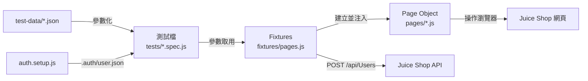

# Playwright × OWASP Juice Shop 自動化測試

[](https://github.com/tengliwei/playwright-juice-shop/actions/workflows/playwright.yml)
[](https://tengliwei.github.io/playwright-juice-shop/)

用 JavaScript 和 [Playwright](https://playwright.dev/) 為 [OWASP Juice Shop](https://github.com/juice-shop/juice-shop) 寫的 E2E 自動化測試，涵蓋註冊、登入、個人資料、搜尋、購物車與完整結帳流程。採用 Page Object Model 與 Fixtures 架構，每條測試透過 API 建立自己的帳號，可以平行跑。每次 push 由 GitHub Actions 自動執行，HTML 報告發佈到 GitHub Pages。

> Juice Shop 是故意留有資安漏洞的練習網站，請只在本機或 CI 裡跑，不要開放到公網。

## 技術棧

| 項目      | 使用                            |
| --------- | ------------------------------- |
| 語言      | JavaScript（ES Modules）        |
| 測試框架  | `@playwright/test` 1.65         |
| 執行環境  | Node.js 24                      |
| 被測系統  | OWASP Juice Shop（Docker 容器） |
| CI / 報告 | GitHub Actions、GitHub Pages    |

## 測試範圍

共 16 條測試（含 1 條登入狀態 setup）。

| 檔案               | 測什麼                                                                            |
| ------------------ | --------------------------------------------------------------------------------- |
| `smoke.spec.js`    | 首頁能打開；歡迎彈窗會被自動關掉，不擋住後續點擊                                  |
| `auth.spec.js`     | 從畫面註冊新帳號，登入後帳號選單顯示註冊的 email                                  |
| `login.spec.js`    | 登入成功、密碼錯誤停在登入頁；Login 按鈕在不同填寫狀態下的啟用／停用（資料驅動）  |
| `profile.spec.js`  | 設定使用者名稱後重新打開頁面仍是新名字；新帳號沒有使用者名稱                      |
| `basket.spec.js`   | 帶登入狀態開購物車會顯示目前帳號；未登入的對照組沒有標題                          |
| `search.spec.js`   | 搜尋並加入一瓶 Apple Juice，購物車數量與總價正確                                  |
| `checkout.spec.js` | 搜尋 → 加入購物車 → 新增地址 → 選送貨方式 → 新增信用卡 → 下單，驗證總價與訂單編號 |
| `auth.setup.js`    | 先跑一次，登入後把登入狀態存成檔案，給需要的測試直接沿用                          |

## 架構



- **測試檔（spec）** 只描述流程與寫斷言，不自己建立 Page Object。
- **Fixtures** 負責準備測試要用的東西：Page Object、用 API 註冊好的新帳號、預先同意 cookie 的瀏覽器環境。
- **Page Object** 只負責找元素和封裝操作（例如 `login(email, password)`），裡面不放任何斷言。

## 資料夾結構

```
├── .github/workflows/playwright.yml   # CI：跑測試、上傳報告、發佈到 GitHub Pages
├── fixtures/pages.js                  # 自訂 Fixtures
├── pages/                             # Page Object（BasePage 與各頁面）
├── test-data/                         # 資料驅動測試用的 JSON
├── tests/                             # 測試檔與 setup
├── playwright.config.js               # Playwright 設定
└── .env.example                       # 環境變數範本
```

## 在本機執行

### 需要先安裝

- [Node.js](https://nodejs.org/) 20 以上（開發時用 24）
- [Docker Desktop](https://www.docker.com/products/docker-desktop/)
- [Google Chrome](https://www.google.com/chrome/)：本機設定使用電腦上的 Chrome（`channel: 'chrome'`），CI 才用 Playwright 自帶的 Chromium

### 步驟

1. 啟動 Juice Shop：

   ```bash
   docker run -d --name juice-shop -p 127.0.0.1:3000:3000 bkimminich/juice-shop
   ```

   之後開關用 `docker start juice-shop` / `docker stop juice-shop`。打開 http://localhost:3000 看到商店首頁就是好了。

2. 下載專案並安裝套件：

   ```bash
   git clone https://github.com/tengliwei/playwright-juice-shop.git
   cd playwright-juice-shop
   npm ci
   ```

3. 建立環境變數檔（可略過，沒有 `.env` 會用預設值）：

   ```bash
   cp .env.example .env
   ```

   | 變數            | 用途            | 預設值                  |
   | --------------- | --------------- | ----------------------- |
   | `BASE_URL`      | Juice Shop 網址 | `http://localhost:3000` |
   | `TEST_PASSWORD` | 測試帳號的密碼  | `111111`                |

4. 執行測試：

   | 指令                  | 說明                                                 |
   | --------------------- | ---------------------------------------------------- |
   | `npm test`            | 無頭模式跑全部測試                                   |
   | `npm run test:headed` | 開著瀏覽器畫面跑                                     |
   | `npm run test:ui`     | Playwright UI 模式（終端機會印出網址，用瀏覽器打開） |
   | `npm run report`      | 打開上一次的 HTML 報告                               |

   失敗的測試會在 `test-results/` 留下 trace、影片、截圖，可以用 `npx playwright show-trace <trace.zip 路徑>` 逐步回放。

## 設計決策與取捨

### 1. 每條測試用 API 建立自己的帳號

`newUser` Fixture 直接呼叫 `POST /api/Users` 註冊一個 email 不重複的新帳號（時間戳＋隨機碼），不走註冊畫面。

- **為什麼**：開發過程實測，多條測試共用同一個帳號時，一條改了使用者名稱或購物車，另一條就會讀到被改過的資料；而且就算 `--workers=1` 一條一條跑也會殘留。每條測試用自己的帳號，才能平行跑、順序打亂也不影響結果。
- **取捨**：每條測試都多一次 API 呼叫。但比 UI 註冊快很多（個人資料測試從 9.7 秒降到 6.9 秒），註冊畫面本身則由 `auth.spec.js` 專門測。

### 2. 登入狀態只存一次，只給只讀的測試用

`auth.setup.js` 先登入一次，把登入狀態存成 `.auth/user.json`，`basket.spec.js` 透過 `storageState` 直接帶著登入狀態開頁。

- **取捨**：共用狀態省時間，但共用的是同一個帳號。所以只給「只讀、不改資料」的測試用；會改資料的測試一律用自己的新帳號。

### 3. 等伺服器回應，而不是拉長斷言時間

註冊、登入、加入購物車、下單這些動作，在 Page Object 裡會先開始等對應的 API 回應，按下按鈕後等回應回來才往下。

- **為什麼**：平行跑時伺服器變慢，實測登入回應要 4.6 秒、註冊後跳頁要 4.9～10.5 秒，超過斷言預設的 5 秒就會偶發失敗。讓動作本身等回應，用的是整條測試 30 秒的時限，斷言時間不用調大，也不用加固定秒數的等待。

### 4. 開頁前預先同意 cookie，不去點掉橫幅

覆寫 Playwright 內建的 `context` Fixture，開頁前先塞入 `cookieconsent_status=dismiss`，cookie 橫幅根本不會出現。

- **為什麼**：原本用 `page.addLocatorHandler` 在橫幅出現時自動點掉，但偶爾會卡住。追進 cookieconsent 套件程式碼發現：橫幅淡入時有約 20ms 是「已顯示但透明度 0」，Playwright 把它當成可見並在這時點擊，結果 cookie 有存、橫幅卻永遠不消失。與其和動畫時機賽跑，不如從源頭讓它不出現。
- 歡迎彈窗沒有這個問題，仍用 `addLocatorHandler` 處理。

### 5. 本機只開 4 個 worker

`workers` 在本機設 4、CI 設 1。

- **為什麼**：本機預設會開 10 個 worker，Juice Shop 被塞爆，實測單一 API 要 6～9 秒，整套 `--repeat-each=3` 會有 1～3 條失敗。限制成 4 個之後連跑 3 次全綠。CI 機器資源少，開 1 個並搭配 retries 2 次。
- **取捨**：犧牲一點速度，換穩定。

### 6. 斷言只看結果，並做反向驗證

- 斷言的是行為和數據：網址變成什麼、購物車數量與總價、訂單編號是否跟 API 回傳的一致、按鈕是否停用，而不是只看「出現成功提示」。
- 要證明某個規則在起作用時放對照組，例如未登入的購物車、兩欄都有填時 Login 按鈕會啟用。
- 每條新測試寫完都會故意改錯期望值，確認它真的會失敗，避免「永遠綠燈」的假測試。

### 7. 定位元素的優先順序

`getByRole` > `getByLabel` > `getByPlaceholder` > `getByTestId` > CSS。不用 XPath、不用 `nth()` 這種靠位置的寫法，短文字按鈕加 `exact: true`。

- **例子**：登入頁有 Login、Login with Passkey、Login with Google 三顆按鈕，`name: 'Login'` 是包含比對、會同時對到三顆，所以要加 `exact: true`。

## CI / CD

[`.github/workflows/playwright.yml`](.github/workflows/playwright.yml) 在 push 或發 PR 到 `main` 時執行：

1. 用 service container 啟動 Juice Shop，`curl --retry` 等它就緒（不寫固定秒數）。
2. `npm ci` 安裝套件，`npx playwright install --with-deps chromium` 安裝瀏覽器與系統依賴。
3. 跑 `npm test`。
4. 無論成功或失敗都上傳 HTML 報告（artifact 保留 14 天）。
5. push 到 `main` 時，另一個 job 把報告發佈到 [GitHub Pages](https://tengliwei.github.io/playwright-juice-shop/)。
